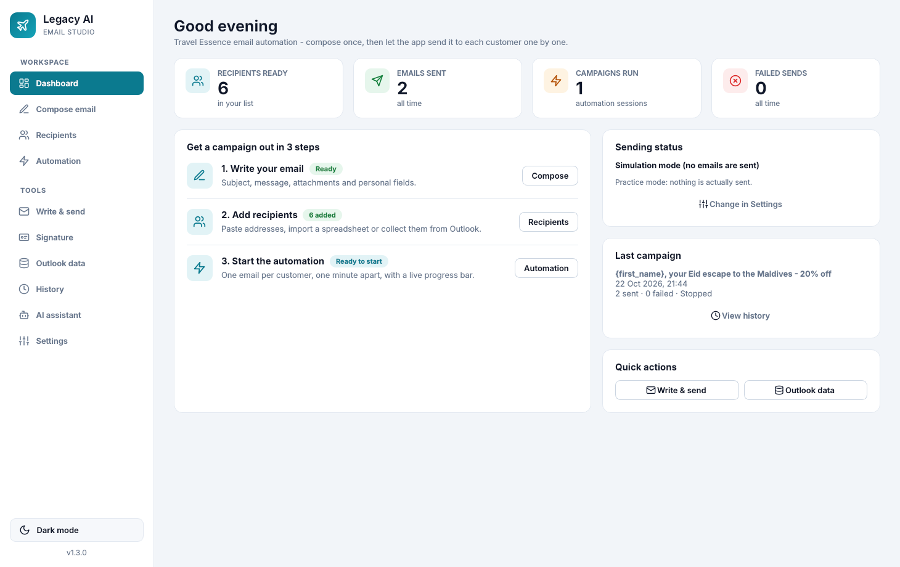
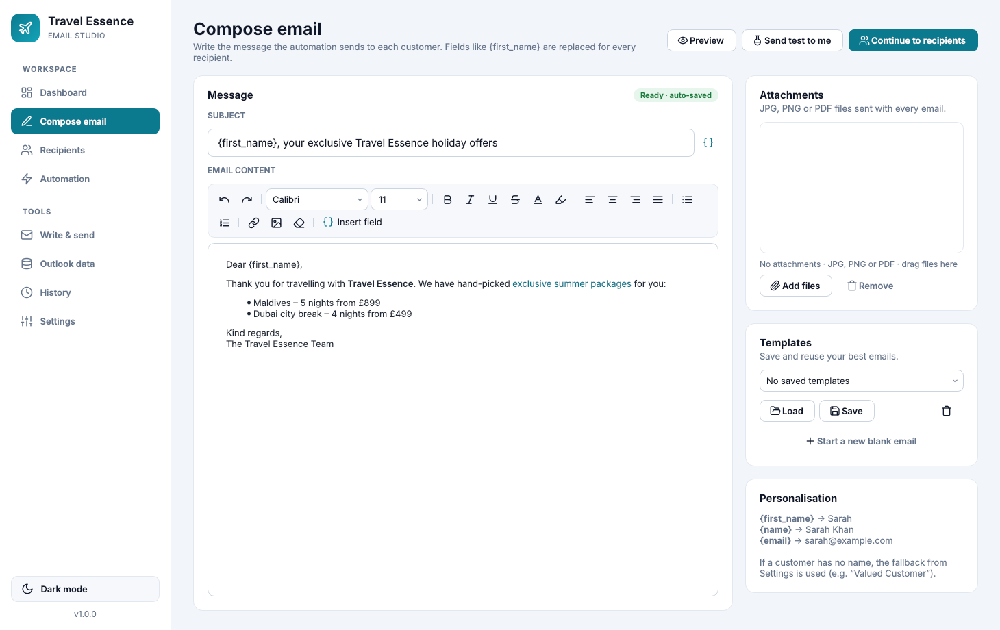
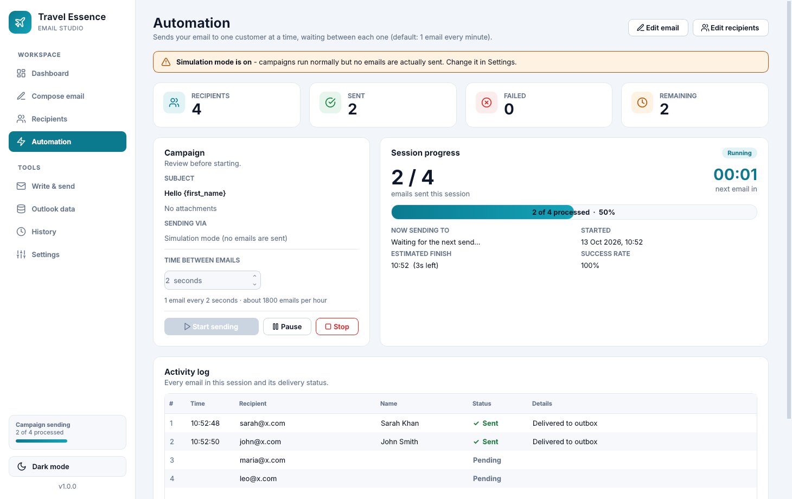
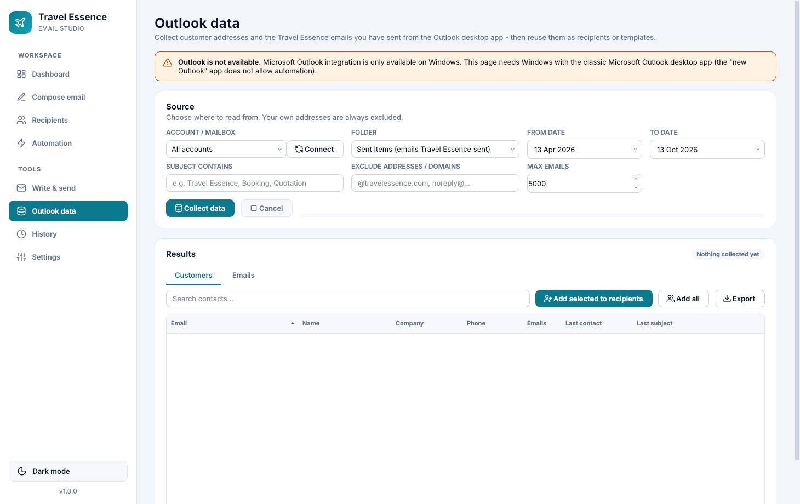
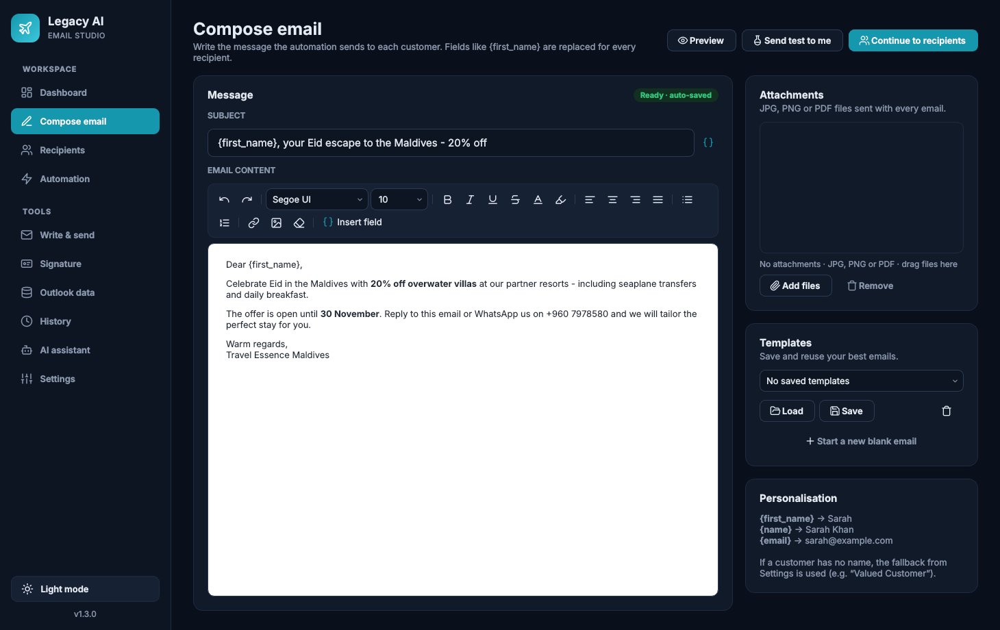
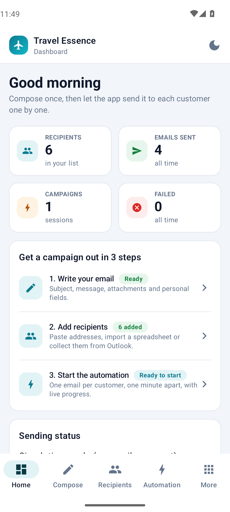
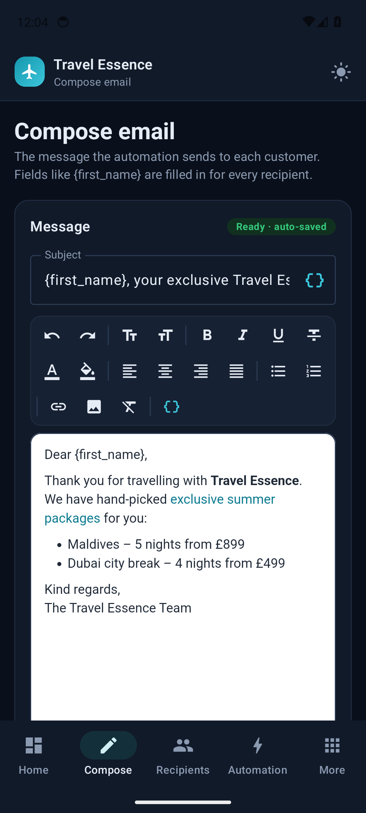
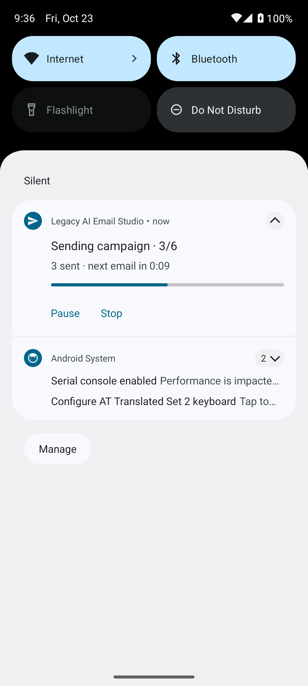

# Travel Essence Email Studio

A native Windows desktop app that sends Travel Essence emails **one customer at a time,
one minute apart**. It works through the Microsoft Outlook app already on your PC, so every
message goes out from the Travel Essence mailbox and is saved in Outlook's Sent Items.



## Features

| # | Feature | Where |
|---|---------|-------|
| 1 | Subject and rich email content (fonts, sizes, bold/italic/underline, colours, lists, links, inline pictures), plus **JPG / PNG / PDF attachments** (button or drag & drop) | **Compose email** |
| 2 | Recipients: **paste addresses in bulk** or **import CSV / Excel / TXT**. Names are picked up from `Name <email>`, spreadsheet columns or copied rows. Duplicates and invalid addresses are removed. | **Recipients** |
| 3 | **Automation**: sends to one customer, waits (default **60 seconds**), then sends to the next. It never sends in bulk. You can pause, resume and stop at any time. | **Automation** |
| 4 | **Collects data from the Outlook desktop app**: reads customer addresses and the Travel Essence emails you sent (Sent Items), received (Inbox) or stored (Contacts). Filter by date, subject and account, add customers to the recipient list, export to Excel/CSV, or reuse a sent email as a template. | **Outlook data** |
| 5 | **Light and dark themes**: toggle at the bottom of the sidebar | Sidebar |
| 6 | **Write & send manually**: compose a one-off email (To/CC/BCC, attachments) and send it immediately | **Write & send** |
| 7 | **Progress bar** for every automation session: sent / failed / remaining, a countdown to the next email, estimated finish time and a live activity log | **Automation** |
| 8 | Clean, professional interface built with Qt, with a dashboard, stat cards and toast notifications | Everywhere |
| 9 | **Standalone Windows app**: a single `.exe` (no Python needed) plus an installer | See below |

Also included:
- **Personalisation**: `{first_name}`, `{name}`, `{last_name}` and `{email}` in the subject or body
  are replaced for each customer. A fallback such as "Valued Customer" is used when a name is unknown.
- **Preview** and **Send test to me** before starting a campaign.
- **Templates**: save and reuse your best emails.
- **History**: every session with a per-customer result. You can export it to CSV or
  **re-queue** customers who did not receive the email.
- **Do-not-email list**: addresses or whole domains that campaigns always skip.
- **Auto-pause** after 3 failures in a row (for example if Outlook was closed).
- Optional **Outlook signature** and a choice of which **Outlook account** to send from.
- **SMTP** sending as an alternative, and a **Simulation mode** for practising without sending anything.

| Compose | Automation in progress |
|---|---|
|  |  |

| Outlook data | Dark theme |
|---|---|
|  |  |

## Android app

There is also a native **Android app** with the same features. It sends through Microsoft 365 / Outlook.com
(saved to Sent Items), SMTP, or simulation, and collects data from your Outlook mailbox, an IMAP mailbox or
the phone's contacts. See [`android/README.md`](android/README.md) for the APK download and the one-time
Microsoft sign-in setup.

| Dashboard | Compose | Campaign notification |
|---|---|---|
|  |  |  |

## Download the Windows app

Every push is built on a Windows machine by GitHub Actions
(`.github/workflows/build-windows.yml`). The build runs the tests, builds the exe and launches it as a check.

1. Open the repository on GitHub, then **Actions → Build Windows app**, and open the latest successful run.
2. Download the **TravelEssenceEmailStudio-windows** artifact (a zip). It contains:
   - `TravelEssenceEmailStudio.exe`: portable, double-click to run.
   - `TravelEssenceEmailStudio-Setup.exe`: installer with Start-menu and desktop shortcuts.

To publish a permanent download on the **Releases** page, push a version tag:
`git tag v1.0.0 && git push origin v1.0.0`.

> Windows SmartScreen may warn about an unrecognised app the first time, because the exe isn't
> code-signed. Click **More info → Run anyway**.

### Build it yourself on Windows

Install Python 3.10+ from python.org, then double-click `build.bat`
(or run it from a terminal). The app is written to `dist\TravelEssenceEmailStudio.exe`.
If [Inno Setup](https://jrsoftware.org/isinfo.php) is installed, the installer is built too.

## Using it

1. **Settings**: choose the sending method. Microsoft Outlook is the default. Click **Load accounts**
   to pick the Travel Essence mailbox if Outlook has more than one account.
2. **Compose email**: write the subject and message and add attachments. Use **Preview** and
   **Send test to me** to check it.
3. **Recipients**: paste addresses or import a spreadsheet, or collect them on the **Outlook data** page.
4. **Automation**: check the summary and the time between emails (60 seconds by default), then press **Start sending**.
   Keep the app and Outlook open until it finishes. Closing the app stops the campaign, and you can
   re-queue the remaining customers from **History**.

### Outlook requirements and tips

- Requires **classic Outlook for Windows** (Microsoft 365 / Outlook 2016-2021), signed in.
  The **"new Outlook"** app does not support automation. Switch back to classic Outlook, or use the
  **SMTP** sending method instead.
- If Outlook shows *"A program is trying to send an email on your behalf"*, make sure your antivirus is
  up to date, or ask your IT admin to allow it under Outlook **File → Options → Trust Center →
  Programmatic Access**.
- With Cached Exchange Mode, emails can sit in the Outbox for a moment before Outlook sends them.
  This is normal.
- Keep the PC awake during long campaigns. If Windows goes to sleep, sending pauses until it wakes.

### Where data is stored

Settings, the current draft, recipients, templates and history are saved as JSON files in
`%APPDATA%\TravelEssenceEmailStudio`. Use **History → Open data folder** to open it. SMTP passwords
are stored in Windows Credential Manager, never in plain files.

## Development

```bash
pip install -r requirements-dev.txt
python main.py          # run the app
python -m pytest -q     # run the tests
```

Project layout:

```
main.py                     entry point
te_mailer/core/             no-UI logic: recipients, HTML, senders (Outlook/SMTP), Outlook data, storage
te_mailer/ui/               Qt interface: theme, icons, editor, workers, pages/
packaging/                  PyInstaller spec, Windows version info, Inno Setup script
tests/                      pytest suite (parsing, HTML, campaign timing/pause/stop, SMTP)
```
